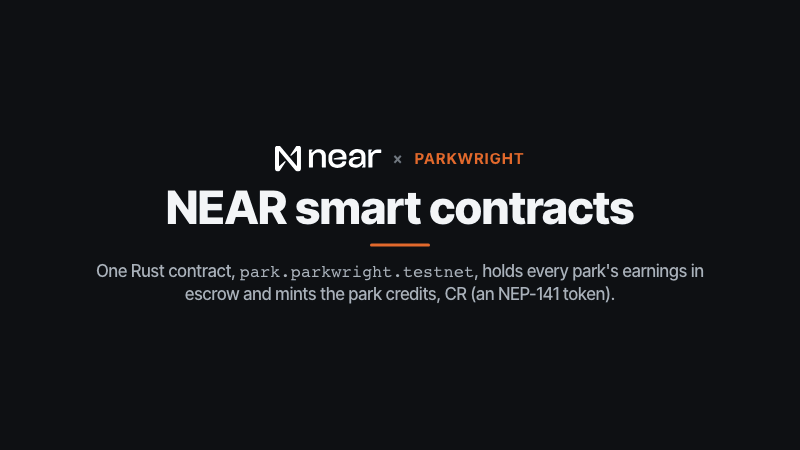
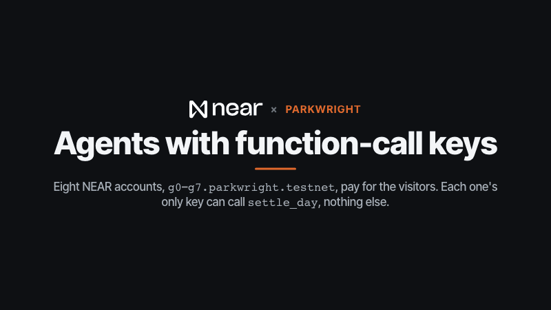
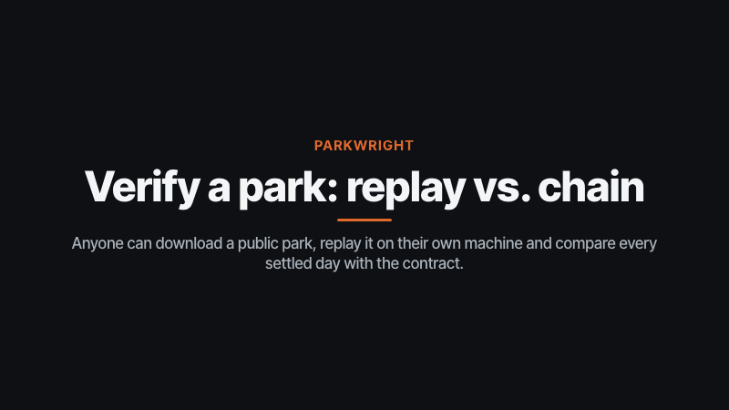
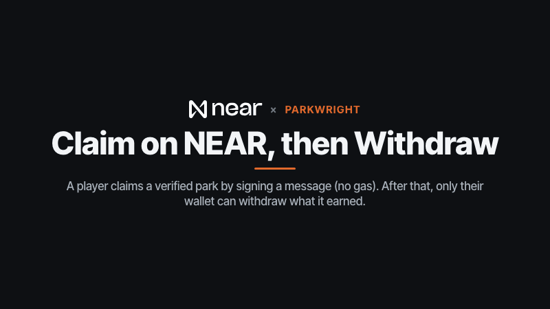
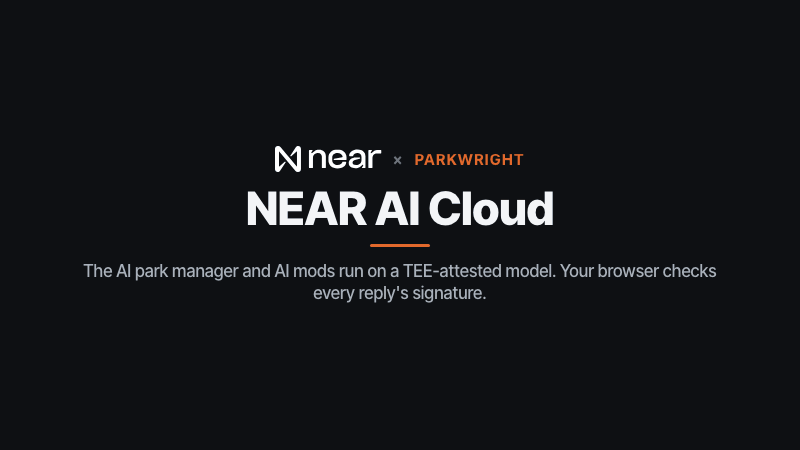
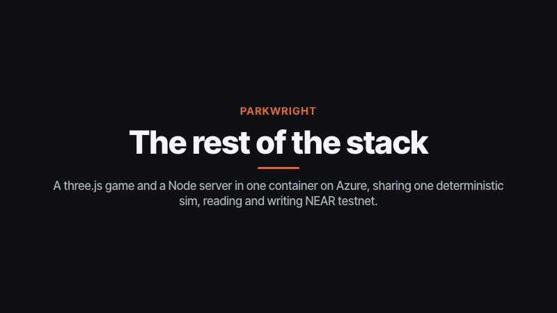

# Parkwright

An original theme-park builder in three.js. You lay paths, build flat rides, coasters and stalls, and simulated visitors decide whether your park is worth their money. The visitors are paid for by agents with their own NEAR testnet accounts and spending caps. You can manage the park yourself in the in-game terminal, or hand it to an AI that runs on private (TEE) inference.

Part of the **NEAR Arcade** submission for [NEAR HACKATHON](https://nearhackathon.com) ([repo](https://github.com/lopeselio/near-arcade), [arcade](https://arcade.lopeselio.online)). The author's other submission is **Signalfire** ([repo](https://github.com/lopeselio/signalfire)).

- **Play:** https://parkwright.lopeselio.online (testnet)
- **Contract:** [`park.parkwright.testnet`](https://testnet.nearblocks.io/address/park.parkwright.testnet). Admin `parkwright.testnet`; visitor agents `g0`–`g7.parkwright.testnet`.
- **Design:** [DESIGN.md](DESIGN.md) is the source of truth for the rules, the economy and the chain.

## The problem

Leaderboards and in-game economies usually ask you to trust the server: whoever runs the game decides what a park "earned". Parkwright makes the money in a park sim checkable:

- The simulation is deterministic. A park is a seed, a scenario and a log of player actions, so anyone can replay it and get the same park, byte for byte.
- Visitor spending is settled on NEAR by agents whose keys can do nothing except pay into parks, within caps the contract enforces.
- Anyone can replay a published park on their own machine and compare it with what the contract recorded: `pnpm verify <parkId>`.

## Tracks

| Track | Evidence |
|---|---|
| **Games** | A full park builder: paths, queues, 6 flat rides, a piece-by-piece coaster with a physics test run, stalls, staff, finance, ratings, visitors with needs and opinions, day/night, sound, touch controls and a guided walkthrough. Deterministic sim with versioned rules (`packages/sim`, DESIGN §6.1). |
| **Privacy** | The AI manager and AI mods run on a TEE-attested model on NEAR AI Cloud, so your park's books go only to attested hardware. Your browser checks every reply's TEE signature against the model's attestation report, and `ai proofs` exports the signed bytes. On chain, only per-day venue totals are recorded, never a per-visitor trail. |
| **Agents** | 8 patron agents (`g0`–`g7`), one per visitor group, each with a single function-call key that can only call `settle_day`, under a 1,000 CR per-day cap and a 5,000 CR per-park-day cap. Two more players: the AI park manager, which may only build and look, within a budget, and Claude Code over MCP (`bridge`). |
| **Open** | MIT. Mods are data-only packs, validated and clamped, that ship inside every save. `pnpm verify` replays any public park locally and checks it against the chain over public RPC. `pw` is a CLI that every interface shares (you, the AI, MCP). |

## What the chain proves, and what it doesn't

**Proves** (enforced by `park.parkwright.testnet`):
- every settlement was signed by a patron agent's own key, and that key can call nothing but `settle_day`;
- no patron pays more than 1,000 CR for a park-day, no park takes more than 5,000 CR a day, a day is paid at most once per patron, and days can't run ahead of real time (20 s per park-day);
- minting is capped at 200,000 CR per 24 h, and credits in accounts plus escrow always equal the total supply;
- once claimed, a park belongs to its owner: only they can withdraw its escrow or transfer it, and the server can never take it back.

**Does not prove:**
- **that the spend came from an honest replay.** The game server replays each save and settles only verified parks, from the replayed numbers, but the contract doesn't re-run the sim. `state_hash` is recorded, not checked. Anyone can re-check a park with `pnpm verify`, which is the point of publishing the full action log.
- **that the patrons are independent.** Their keys belong to the game (the server signs for them). The contract only bounds what they can do.
- **ownership of an unclaimed park.** Until a player claims it, a park is held by `parkwright.testnet`.
- **value.** CR are testnet play credits.

## Try it (hosted)

```sh
URL=https://parkwright.lopeselio.online
```

- Do: open $URL. See: the title screen. A fresh browser shows **Play** (with the starting park's name, Meadowbrook), **New park** and **How to play**. Once you've played, **Play** becomes **Continue** with your park's day.
- Do: **New park**. See: Meadow Start ("starts with 15,000 cr + 10,000 cr loan", so the HUD shows 25,000 cr) and Sandbox.
- Do: `curl -s $URL/api/leaderboard`. See: the verified parks, ranked by the rating the server's replay produced, including the showcase parks below.
- Do: `pnpm install && pnpm verify f54720d4972a7f34`. See: the save downloaded from $URL, replayed locally ("replay MATCH"), `get_park` read straight from testnet RPC, and a per-day table of what the replay says the agents should have paid next to what the contract recorded, ending in `VERIFIED` (exit 0). If you catch a park while its agents are still paying a day, that day shows as "settling" and the totals as "ok so far". Output from 2026-11-12:

```
$ pnpm verify f54720d4972a7f34
Parkwright park f54720d4972a7f34
  host      https://parkwright.lopeselio.online
  contract  park.parkwright.testnet (testnet)

save      "Brass Meadow", version 1, rules v2, scenario meadow, seed 3
          106 actions, tick 37820 (day 22), 27 venues, 1257 visitors, sha256 0db0a8cae17d6a52…

replay    MATCH: replay matches the save (675 ms, locally with @parkwright/sim)
          replayed rating 5.80, 1257 visitors, 21 finished days
          the host says: verified true (replay matches the save)

chain     get_park via https://testnet-rpc.intea.rs
          owner parkwright.testnet (unclaimed: the game server holds it until a player claims it), escrow 41,956.60 CR, earned 41,956.60 CR, 168 settlements

  day   replay says      on chain
   14    2,458.90 CR    2,458.90 CR  ok
   15    2,544.40 CR    2,544.40 CR  ok
   16    2,705.20 CR    2,705.20 CR  ok
   17    2,732.80 CR    2,732.80 CR  ok
   18    2,845.60 CR    2,845.60 CR  ok
   19    2,784.60 CR    2,784.60 CR  ok
   20    2,619.80 CR    2,619.80 CR  ok
   21    2,785.70 CR    2,785.70 CR  ok

  earned       replay 41,956.60 CR, chain 41,956.60 CR  ok
  settlements  replay 168, chain 168  ok  (one settle_day per visitor group per day)

VERIFIED: the save replays exactly and every settled day matches the replay
  contract  https://testnet.nearblocks.io/address/park.parkwright.testnet
```

- Do: `curl -s $URL/api/parks/f54720d4972a7f34/verify` and `curl -s $URL/api/parks/f54720d4972a7f34/chain`. See: the server's own verdict (`"verified": true`), then the park's escrow, earnings, settlement count and recent days, read from the contract.

**Showcase parks.** Each was built only with `pw` commands (the reference park builders in `packages/sim/scripts/parks.ts`), published through the public API like the browser does, then verified by replay and settled by the agents. Open any of them with `$URL/?park=<id>`; you get your own copy to play.

| Park | id | What's in it | Settled on chain |
|---|---|---|---|
| Brass Meadow | `f54720d4972a7f34` | Meadow, 21 days: 27 venues, 1,257 visitors, rating 5.80 | 41,956.60 CR in 168 settlements |
| Lantern Hollow | `54a722918895cef9` | Sandbox, 10 days: 30 venues, 1,719 visitors, rating 6.96 | 16,669.60 CR in 80 settlements |
| Marigold Midway | `0c4b02cc0ff3e4c4` | Meadow, 14 days: 27 venues, 939 visitors, rating 5.48 | 23,118.60 CR in 112 settlements |
| Judge Park | `5646276b0bfcba1a` | Meadow, built by hand in the hosted game during a judge rehearsal | 394.20 CR in 53 settlements |

**Claim on NEAR** (wallet): a claim transaction will be cited here after the owner's wallet pass: _pending_.

## Built on NEAR

What each NEAR technology does in Parkwright, and where to look. Each GIF is a short loop (12 seconds or less).

| Technology | What Parkwright uses it for | Where to look |
|---|---|---|
| NEAR smart contracts (Rust, near-sdk 5.29) | the park contract: parks and their escrow, patron budgets and caps, bounded minting, claims, withdrawals | [`contracts/park`](contracts/park/src/lib.rs), [`park.parkwright.testnet`](https://testnet.nearblocks.io/address/park.parkwright.testnet) |
| NEP-141 fungible token | the park credits (`CR`, 2 decimals): patron budgets, park escrow and owners' balances | `ft_*` in [`lib.rs`](contracts/park/src/lib.rs) |
| Function-call access keys (agent accounts) | the 8 patron agents `g0`–`g7.parkwright.testnet`, whose only key can call `settle_day`; the server's admin key is limited to four admin methods | [`setup-patrons.ts`](packages/chain/src/setup-patrons.ts), [`settle.ts`](apps/server/src/settle.ts), [`g0.parkwright.testnet`](https://testnet.nearblocks.io/address/g0.parkwright.testnet) |
| Public testnet RPC | `pnpm verify` replays a park locally and compares it with `get_park`, read over public RPC | [`verify-park.ts`](apps/server/scripts/verify-park.ts) |
| NEAR Connect, NEP-413 signed messages | **Claim on NEAR** (a signed message, no gas) and **Withdraw earnings** (a `withdraw` call) from the player's wallet | [`apps/web/src/wallet.ts`](apps/web/src/wallet.ts), [`apps/server/src/claim.ts`](apps/server/src/claim.ts) |
| NEAR AI Cloud | the AI park manager and AI mods on a TEE-attested model; the browser checks every reply's signature | [`packages/ai`](packages/ai/src/nearai.ts), [`apps/server/src/ai.ts`](apps/server/src/ai.ts) |

### NEAR smart contracts: the park contract



One Rust contract, [`park.parkwright.testnet`](https://testnet.nearblocks.io/address/park.parkwright.testnet)
([`lib.rs`](contracts/park/src/lib.rs)), mints the park credits (CR, an NEP-141 token) and holds what every park earned
in escrow. The server registers each published park with `register_park` and mints the patrons' budgets with
`fund_patrons` (at most 200,000 CR per 24 h, so even a leaked admin key can only create a bounded amount). Only a
park's owner can `withdraw` its escrow or `transfer_park` it, and `audit` reports that credits in accounts plus escrow
equal `ft_total_supply`.

### Patron agents: function-call keys that can only pay



Visitors arrive in 8 groups, and each group is paid for by an agent with its own NEAR account, `g0`–`g7.parkwright.testnet`,
whose only key is a function-call key for `settle_day` on the contract ([`setup-patrons.ts`](packages/chain/src/setup-patrons.ts)).
The settlement worker ([`settle.ts`](apps/server/src/settle.ts)) pays a day only after the server's replay of the save
reproduced its state hash exactly ([`verify.ts`](apps/server/src/verify.ts)). The contract refuses a day already paid,
a day ahead of real time, and anything over 1,000 CR a group or 5,000 CR a park for one day.

### Verify a park: replay it, then read the chain



`pnpm verify <parkId>` ([`verify-park.ts`](apps/server/scripts/verify-park.ts)) downloads a public save, replays it
on your machine with `@parkwright/sim`, reads `get_park` over public testnet RPC (intea, then dRPC, then FastNEAR),
and compares each recent day, the total earned and the settlement count with what the replay says the agents should
have paid. It exits 0 only when everything matches; the run for Brass Meadow is in [Try it](#try-it-hosted).

### Claim on NEAR and Withdraw: the player's wallet



**Claim on NEAR** opens NEAR Connect ([`wallet.ts`](apps/web/src/wallet.ts)); the wallet signs
`Claim Parkwright park <id>` (NEP-413) over a one-time, 5-minute challenge, with a full-access key. The server
([`claim.ts`](apps/server/src/claim.ts)) also checks the park's secret key and its replay, then calls `assign_park`,
which the contract allows only while the admin still holds the park, so a claim is final. **Withdraw earnings** has
the owner's wallet sign `withdraw` (1 yoctoNEAR), which moves the escrow to their CR balance.

### NEAR AI Cloud: an AI manager you can check



The AI park manager (`ask`) and the mod designer (`mod ai`) use `Qwen/Qwen3.6-35B-A3B-FP8` on NEAR AI Cloud
([`nearai.ts`](packages/ai/src/nearai.ts), [`ai.ts`](apps/server/src/ai.ts)). The model can only propose `pw`
commands or a data-only mod, which the game validates like any player input. Your browser checks that each reply's
signature covers exactly that request and reply, and that the signer is in the model's attestation report
([`verify.ts`](packages/ai/src/verify.ts)); `ai proofs` downloads the signed bytes.

### The rest of the stack



A three.js client with an xterm.js terminal ([`apps/web`](apps/web/src/main.ts)) and a Node 22 server
([`apps/server`](apps/server/src/main.ts)) in one container on Azure Container Apps, with saves in Cosmos DB and
Redis for caching and locks. The deterministic sim ([`packages/sim`](packages/sim/src/index.ts)) is the same code in
your tab, in the server's replay worker and in `pnpm verify`.

## Play locally

- `pnpm install`, then `pnpm --filter @parkwright/web dev` and open http://localhost:5180.

## First run

- Do: open the game. See: a title screen with **Play** (your park's name; **Continue** once you've played), **New park** (pick Meadow or Sandbox and name your park) and **How to play**.
- Do: start a park. See: a four-card welcome (Next/Back/Skip, arrow keys, Esc). Then **Show me how** starts a hands-on walkthrough that highlights each control and waits for you: pick Path, drag a path from the gate, open Rides, place a ride, place a stall, inspect it, speed up time. **End tour** stops it at any point.
- Do: press `?` or the **?** button in the top bar. See: the rules and controls sheet, with buttons to replay the welcome, restart the walkthrough or start a new park. Add `?play` to the URL to skip the title screen.
- Do: look at the top bar and toolbar. See: one set of line icons (no emoji): the park name, Cash, Rating and Visitors pills, pause and speed buttons with the speaker, then Finance, Visitors, Staff, Parks, the terminal and help. Panels slide in; on a phone the top bar is three rows (name and speeds, stats, menu) and the toolbar is a bottom bar.
- Do: let a park day run (90 s at 1×). See: the light follow the park's clock: a warm morning, a long day, a golden evening and a short blue dusk where the bulbs on rides, lamps and the gate glow and lamps pool light on the paths. Purely visual; the sim doesn't know the time of day. In the console, `parkwright.world.timeOfDay = 0.93` pins the dusk look (`null` lets it run again).
- Do: click a ride with **Inspect**. See: its panel, and a pulsing gold outline round it in the park.
- Do: open **Rides → Timber Coaster**, click a tile for the station, then point at a piece button. See: a see-through preview of that piece at the track's open end, with the tiles it takes and an arrow for where the track heads next. It's green if the piece fits; red if it doesn't, with the reason in the panel (e.g. "tile 48,34 is not clear"). Pieces that can't fit are dimmed. With nothing hovered, it previews the last piece you added.

- Do: open the game on a phone or tablet. See:
  - one finger taps to build or select, and drags to lay paths (with **Inspect** selected, a drag pans);
  - two fingers pinch to zoom, drag to pan, and a quarter twist turns the view;
  - **⟲ R ⟳** buttons in the bottom-right corner turn the view and rotate the piece you're placing.
  - On a desktop, right-drag also pans.

- Do: click anywhere, build a path and a ride, and let time run. See (hear): a thunk for building, a tick for each path tile, a chime as visitors arrive, coins as they spend, a little tune when a ride starts, the chain clack and rush of a coaster run, and a crowd murmur that grows with the park. It's all synthesized in the browser (no audio files). **M**, or the speaker button at the end of the speed controls in the top bar, mutes it and the setting is remembered.

Press `` ` `` to open the park terminal and type `help`. Try `path place 24 33 24 40`, then `ride build teacups 21 34 --rot 1`, then `ride open teacups`. Visitors walk in from the gate and queue for the ride.

## Tests

- Do: `pnpm test`. See: the sim, server, chain and AI unit tests.
- Do: `pnpm --filter @parkwright/sim balance --days 42 --every 7`. See: three reference parks (starter, mid, big) built with `pw` commands, with visitors, rating, cash, income, spend per day and ms per simulated day. A good mid-sized park reaches about 1,000–1,300 visitors in three weeks. Add `--stress 500,1000,1500` to time one day at each crowd size, or `--rules 1` for the original rules (see DESIGN §6.1).
- Do: `pnpm e2e` (first time: `pnpm --filter @parkwright/e2e exec playwright install chromium`). See: it builds the web app, starts the real server on :8931 with file saves and no chain or AI keys, and headless Chromium checks the title screen and New park flow, building a path and a ride (ride count up, cash down by the cost), `?` and Esc for How to play, and Publish & share followed by `/api/parks/<id>/verify` reporting `verified: true`, with no console errors. CI runs the same in the `e2e` job and uploads the Playwright report when it fails.

## Host it

`scripts/deploy-azure.sh` builds the image in Azure Container Registry and rolls out the Azure Container App (resource group `parkwright`, North Europe). The first run creates everything. It prints the URL and checks `/api/health`.

## NEAR (testnet)

Visitors arrive in 8 groups. Each group is paid for by an agent with its own NEAR account (`g0`–`g7.parkwright.testnet`), whose only key can call `settle_day` and nothing else. When a park syncs to the cloud, each agent settles its visitors' spend for every finished day into the park, on the contract `park.parkwright.testnet`.

- Do: open the game, build a ride, press **Parks → Publish & share**, and let two in-game days pass. See: the Parks panel shows "On NEAR testnet" with the credits settled into your park, and a link to the contract on NearBlocks.
- Do (owner, once): `./scripts/set-insights-secret.sh`. See: an Application Insights resource `parkwright-insights` on the app's Log Analytics workspace; after the restart, *Live metrics*, *Failures* and *Performance* in the portal show the server's requests, Redis/Cosmos/NEAR calls and exceptions (25% of requests sampled; `INSIGHTS_SAMPLING` changes it).
- Do (owner, once): `./scripts/backup-policy.sh`. See: Cosmos DB keeps a geo-redundant backup every 4 hours for 7 days (`backupRetentionIntervalInHours: 168`) instead of 8 hours.
- Do (with `URL=https://parkwright.lopeselio.online`): `curl $URL/api/parks/<id>/verify`. See: whether the server's replay of every action reproduced the save exactly. Only verified parks settle on NEAR or appear on the leaderboard. A park with no result yet is replayed when you ask (a long one says "pending" for a few seconds). A park that is on chain but whose save was published to another server gets a 404 that says so (`"onchain": true`).
- Do: `pnpm verify <id> [host]`. See: the same replay run on your machine, plus each settled day compared with `get_park` read over public testnet RPC (falls back from intea to dRPC to FastNEAR and backs off on 429s; `NEAR_RPC=` to choose one). Exits 0 when it all matches.
- Do: `curl $URL/api/parks/<id>/chain`. See: the park's escrow, earnings and settlement count, read from the contract, plus `claimed`.
- Do: publish a park, keep playing until the Parks panel shows **✓ Verified**, then press **Claim on NEAR** and pick a testnet wallet in the NEAR Connect picker (e.g. Meteor or HOT). See: the wallet asks you to sign "Claim Parkwright park <id>" (a message, not a transaction, so no gas), then the panel shows you as **Owner**, and `/chain` reports `"claimed": true`. Once it has earned something, **Withdraw earnings** asks your wallet to sign a `withdraw` call (1 yoctoNEAR), and the escrow moves to your CR balance (`ft_balance_of`).
- Do: press **Profile** in the toolbar, then **Connect wallet** (NEAR Connect, nothing is signed). See: your account, CR balance (`ft_balance_of`), the parks your account owns on `park.parkwright.testnet` with what each earned, its settlements and leaderboard rank, totals across them, and **Withdraw** next to any park with earnings waiting. The same data as JSON: `curl $URL/api/players/<account>.testnet` (read from the contract, cached 30 s).
- Do: `cd contracts/park && cargo test`. See: 18 tests covering caps, replays, withdrawals, transfers and credit conservation.
- Setup (once, by the owner): `cargo near deploy …` (see DESIGN §9), then `pnpm --filter @parkwright/chain setup:patrons`.
- Do: `pnpm check:gas`. See: a table of the NEAR balance of `parkwright.testnet` and `g0`–`g7` (they pay their own gas), read with the public `view_account` RPC. It exits 1 if any is below 0.1 NEAR (`GAS_MIN_NEAR=0.5 pnpm check:gas` to change that). The `gas-watch` workflow runs it every 6 hours and opens an issue labelled `low-gas` (or comments on the open one). With settlement on, `curl $URL/api/health` shows the same as `gas.low`, refreshed at most every 10 minutes.

## AI park manager and AI mods (NEAR AI, private inference)

Both run on a TEE-attested model on NEAR AI Cloud. The model can only propose `pw` commands or a data-only mod, which the game validates like any player input. Your browser checks each reply's TEE signature itself: the signature must cover exactly that request and reply, and the signing key must be in the model's attestation report.

- Do: open the terminal (`` ` ``) and type `ask "build a swing ride and a lemonade stand and connect them" --budget 3000`. See: the manager says what it's doing, runs `pw` commands, recovers from errors using the game's hints, and prints "✓ signed in a TEE … verified here" for each turn. If it repeats a command that already failed, the game doesn't run it again: it sends back the error with a path route worked out from the hint, and stops the manager after two stuck turns.
- Do: `mod ai "a haunted drop tower and a hot cocoa cart"`, then `mod apply`. See: the new ride and stall in the Rides and Stalls drawers and in `pw ride types`. Ids are namespaced and every number is clamped, so a mod can't break the game or replace base content. Published parks carry their mods, so visitors see them too. Load mods on day 0 (a new park, still paused) to keep the park claimable: the server's replay applies a save's mods from the first tick, so a mod loaded later makes the park unverifiable. `mod apply` warns first and needs `mod apply --anyway` for a park that has already started, and the Parks panel says why an unverifiable park won't settle.
- Do: `ai proofs`. See: a JSON download with the exact signed request/response bytes and signatures, which anyone can re-check.
- Do: `coaster place --name "Timber Dragon"`. See: the game finds a clear area of about 12×8 tiles near the paths, builds a starter coaster piece by piece (chain lift, drop, wide turn, brakes), lays a path to its entrance, runs the test train, prints the ratings and opens it. `--near x,y` picks where to look. It is made only of ordinary actions, so a park with one still verifies.
- Do: `pw ride place teacups`. See: the game finds room near the paths, builds, connects the entrance and opens the ride (the manager uses this too).

## Let Claude Code play your park (MCP)

- Do: in the game's terminal, type `bridge`. See: a one-time link like `https://…/mcp/<code>` and the command to add it.
- Do: in a shell, `claude mcp add --transport http parkwright <that link>`, then ask Claude "use the parkwright tools to build me a food court". See: each command Claude runs appears in your terminal as `claude › pw …`, and the camera follows it.
- Tools: `pw` (any terminal command) and `park_overview` (status, rides, finance, thoughts). Commands run in your tab through the same validated actions as yours. The link is the only key: 128 bits, valid only while the tab is open. `bridge off` revokes it.
- Hosted, the server relays between replicas through Redis pub/sub, so it works whichever replica Claude's requests land on.
## 3D models (Blender)

The ride, stall and scenery models (five kinds of broadleaf tree, three conifers, three flower beds, two hedges, the fountain, benches, lamps, bins, the park fence and gate, the arch over each ride entrance and the coaster car) are generated by Python scripts in Blender (`assets/blender/models.py`, `common.py`). The built `.glb` files are committed, so you don't need Blender to play.

- Do: `./scripts/build-assets.sh` (needs Blender 4.x; set `BLENDER=` if it isn't on your PATH). See: 9 files in `apps/web/public/models` (8 rides and stalls plus `scenery.glb`) and `manifest.json`; each export prints its triangle count. `PW_TRIS=1` also lists the triangles per joined mesh. The six flat rides carry riders, lamps, a booth or name board and strings of bulbs that brighten at dusk; each stays within its footprint and keeps its animated nodes.
- Conventions: 1 unit = 1 tile, origin at the footprint centre, fronts face −Y in Blender (+Z in the game). Parts named `spin`, `wheel` or `carriage` animate while the ride runs, and `hang*` cabins on a wheel stay level. Parts painted `accent` take the ride's colour in the game (a stall's roof and awning, a ride's entrance arch, each coaster car, and a ride's signature parts: the carousel's rounding board, the teacups' floor and crown, the wheel's rims, the swing canopy, the drop tower's bands), so a mod ride that reuses a model shows its own colour. A scenery kind with several looks (`prop_oak_a` … `prop_oak_e`) gets one per tile for trees and one per 4×4 block for beds and hedges, so a planted row matches. Any model missing from the manifest falls back to the procedural mesh, which is how mod rides look.

## Claude terminal (local only): mod with your own Claude Code

On your own machine, the game's terminal can run your real `claude` CLI, connected to your park.

- Do: `PW_CLAUDE_TERMINAL=1 pnpm --filter @parkwright/server start` (after building the web app), open http://localhost:8790, open the terminal and type `claude`. See: Claude Code inside the game. Ask it, for example, "make a mod with a balloon stall and a gentle kiddie coaster-like flat ride, load it and place one". It writes mod files in `mods/workspace/`, loads them with the `mod_apply` tool (validated like `mod ai`), and builds with `pw`. Ctrl+] returns to the park terminal.
- Limits: it's off unless `PW_CLAUDE_TERMINAL=1`, and only a loopback request with a `localhost` Host from a same-origin page can open it. The hosted image never sets the flag. Claude is pre-approved only for this park's tools plus reading and editing files inside `mods/workspace/`; other paths ask you, and it can't edit its own `.claude` settings. Bash and web tools are disallowed, and everything else still asks you first.
- Needs `claude` and `python3` on your PATH (a tiny Python helper gives it a real terminal; no native Node modules).
